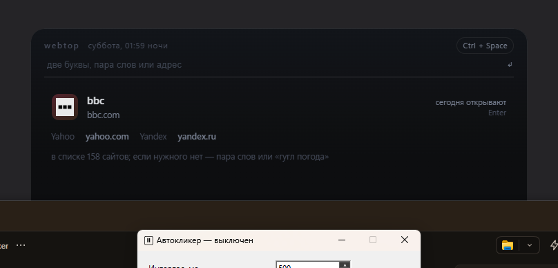

# webtop

Одно поле. Один ответ. Никаких «сотни сайтов».

webtop живёт в фоне: по `Ctrl+Space` поверх любого окна появляется полупрозрачная карточка,
ты набираешь две буквы или пару слов — и сайт открывается **в твоём обычном браузере**.
Карточка прячется, браузер продолжает работать как раньше.



## Скачать

[Releases → webtop-windows-x64.exe](/releases/latest) — один файл ~50 МБ, Windows 10/11 x64.
Нужен WebView2 Runtime (уже есть в Windows 11 и в любом установленном Edge).
Устанавливать ничего не надо: скачал → запустил → он в трее.

## Как это работает

Ранжирование считается на месте, без запросов к поисковику:

```
итог = популярность_сайта × качество_совпадения × твоя_история
```

- **популярность** — список из 158 самых посещаемых сайтов мира (внутри exe, работает офлайн; порядок = вес);
- **совпадение** — точное имя/домен/алиас > начало слова > подстрока > по буквам;
- **история** — сколько раз и как недавно ты сам это открывал (свежий визит за 30 минут даёт заметный буст).

Поэтому «вид» → YouTube, а не список из сорока ссылок: показывается победитель и максимум две
альтернативы тихим текстом.

### Расширенный поиск

| набираешь | что получится |
|---|---|
| `ozon` | один сайт — сразу открылся |
| `карты яндекс` | поиск «карты яндекс» на Яндексе |
| `yt коты` | результат на YouTube, `гугл погода` — в Google |
| `музыка`, `кино` | категория: лучший сайт категории сверху, остальные — альтернативы |
| `www.avito.ru/rossiya/noutbuki` | адрес распознан и открыт как есть |
| `рецепт блинов` | локально ничего не найдено → подсказки из интернета (Google, Яндекс, …) |

Пустое поле — не «популярное вообще», а то, что чаще всего открывают **сегодня**:
выборка стабильна на сутки и зависит от времени дня (утром — новости и почта, вечером — видео).

Раскладка не важна: `jpjy` (озон в английской раскладке) и `озон` дают один результат.

## Вызов и клавиши

| | |
|---|---|
| `Ctrl+Space` | показать / спрятать карточку (глобально, из любого окна) |
| повторный запуск exe | то же самое: окно одно, второй экземпляр его вызывает |
| `Enter` | открыть победителя в браузере по умолчанию |
| `Esc` | очистить поле, ещё раз `Esc` — спрятать |
| клик мимо карточки | прятает её |

Если `Ctrl+Space` уже занят чужой программой, webtop сам пробует `Alt+Space`, потом `Ctrl+Alt+K`
и пишет в лог, что в итоге взял. В меню значка в трее: вызвать, «Запускать с Windows», выйти.

## Приватность

История лежит локально: `%LOCALAPPDATA%\WebTop\history.json` — только то, что ты открывал через webtop,
свёрнутое до домена (`youtube.com`, а не каждый URL). Телеметрии нет, аккаунтов нет,
на сторонние серверы ничего не уходит (иконки сайтов тянутся с обычного `google.com/s2/favicons`,
без них остаются цветные буквы).

## Ограничения

Честно о том, чего здесь нет: это не браузер, а вызываемый поиск поверх него.

- страницы не открываются внутри webtop — только в твоём браузере; вкладок, закладок и паролей нет;
- одна карточка фиксированного размера, без окон и нескольких экранов;
- глобальная клавиша может оказаться занятой — см. список запасных выше;
- список сайтов редактируется правкой массива `RAW` в [www/start.html](/www/start.html) —
  после изменения пересобери exe.

## Сборка из исходников

```
dotnet publish webtop.csproj -c Release -o publish
```

Нужен .NET 10 SDK. Получится один `publish/webtop.exe`.

Что внутри:

- [Program.cs](/Program.cs) — скрытый старт, трей, глобальная клавиша, полупрозрачная карточка
  без рамки, открытие URL через оболочку Windows; мост `postMessage` ↔ `ExecuteScriptAsync`; история в JSON.
- [www/start.html](/www/start.html) — весь интерфейс и весь алгоритм поиска; список сайтов там же.

Проверка без мыши: `WEBTOP_SELFTEST=1` прогоняет 15 поисковых случаев и пишет результат в лог,
`WEBTOP_SELFTEST=2` проверяет, что ссылка уходит в браузер.
`WEBTOP_DEV=1` включает DevTools и контекстное меню. Лог: `%LOCALAPPDATA%\WebTop\log.txt`.

## Лицензия

MIT — см. [LICENSE](/LICENSE).
