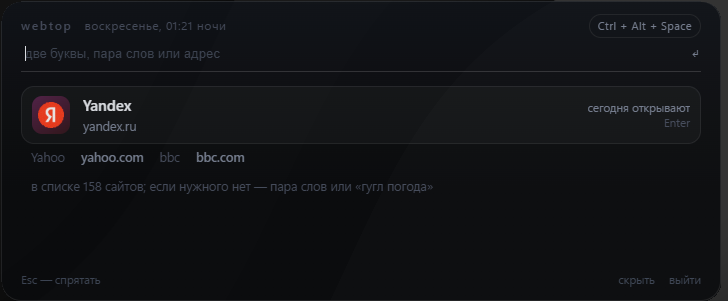

# webtop

Одно поле. Один ответ. Никаких «сотни сайтов».

webtop живёт в фоне: по `Ctrl+Alt+Space` поверх любого окна появляется полупрозрачная карточка,
ты набираешь две буквы или пару слов — и сайт открывается **в твоём обычном браузере**.
Карточка прячется, браузер продолжает работать как раньше.



## Скачать

[Releases → webtop-windows-x64.exe](/releases/latest) — один файл ~50 МБ, Windows 10/11 x64.
Нужен WebView2 Runtime (уже есть в Windows 11 и в любом установленном Edge).
Устанавливать ничего не надо: скачал → запустил → он в трее.

## Как это работает

Ранжирование считается на месте, без запросов к поисковику:

```
итог = популярность_сайта × качество_совпадения × твоя_история
```

- **популярность** — список из 158 самых посещаемых сайтов мира (внутри exe, работает офлайн; порядок = вес);
- **совпадение** — точное имя/домен/алиас > начало слова > подстрока; слабые совпадения по отдельным буквам не считаются найденным сайтом;
- **история** — сколько раз и как недавно ты сам это открывал (свежий визит за 30 минут даёт заметный буст).

Поэтому «вид» → YouTube, а не список из сорока ссылок: показывается победитель и максимум две
альтернативы тихим текстом.

### Расширенный поиск

| набираешь | что получится |
|---|---|
| `ozon` | один сайт — сразу открылся |
| `карты яндекс` | поиск «карты яндекс» на Яндексе |
| `yt коты` | результат на YouTube, `гугл погода` — в Google |
| `музыка`, `кино` | категория: лучший сайт категории сверху, остальные — альтернативы |
| `www.avito.ru/rossiya/noutbuki` | адрес распознан и открыт как есть |
| `рецепт блинов` | локально ничего не найдено → Enter открывает первый сайт по запросу в Google |

Если совпадений в каталоге нет, webtop запрашивает первый результат Google и открывает сайт
в твоём браузере. Запрос отправляется только после Enter или выбора карточки, не при наборе.
Если Google не отдаёт адрес (например, требует CAPTCHA), открывается обычная выдача Google.

Пустое поле — не «популярное вообще», а то, что чаще всего открывают **сегодня**:
выборка стабильна на сутки и зависит от времени дня (утром — новости и почта, вечером — видео).

Раскладка не важна: `jpjy` (озон в английской раскладке) и `озон` дают один результат.

## Вызов и клавиши

| | |
|---|---|
| `Ctrl+Alt+Space` | показать / спрятать карточку (глобально, из любого окна) |
| повторный запуск exe | то же самое: окно одно, второй экземпляр его вызывает |
| `Enter` | открыть победителя в браузере по умолчанию |
| `Esc` | очистить поле, ещё раз `Esc` — спрятать |
| клик мимо карточки | прятает её |

Комбинацию webtop не перехватывает, а опрашивает: раз в 20 мс читает физическое состояние клавиш
(`GetAsyncKeyState`). Поэтому её не может «съесть» переключатель раскладки или чужой перехватчик,
она срабатывает из любого окна, а клавиши при этом полностью достаются играм и другим программам.
Активную комбинацию видно и в шапке карточки, и в меню значка в трее.

Свою комбинацию задаёшь одной строкой в файле `%LOCALAPPDATA%\WebTop\hotkey.txt` —
например `ctrl+alt+space`, `win+d` или `shift+f5` (модификаторы `ctrl` `alt` `shift` `win` + буквы,
цифры, `space`, `enter`, `esc`, `tab`, `f1`–`f12`), после чего webtop нужно перезапустить.
Можно и вовсе одну клавишу без модификаторов (`f9`) — но учти: она же будет вызывать карточку
прямо во время игры, а webtop ничего не перехватывает, так что клавиша уйдёт и в игру.
В меню значка в трее: вызвать, «Запускать с Windows», выйти.

## Приватность

История лежит локально: `%LOCALAPPDATA%\WebTop\history.json` — только то, что ты открывал через webtop,
свёрнутое до домена (`youtube.com`, а не каждый URL). Телеметрии нет, история никуда не отправляется.
Если совпадений нет, после Enter запрос отправляется в Google для получения первого сайта.
Иконки сайтов тянутся с `google.com/s2/favicons`; без них остаются цветные буквы.

## Ограничения

Честно о том, чего здесь нет: это не браузер, а вызываемый поиск поверх него.

- страницы не открываются внутри webtop — только в твоём браузере; вкладок, закладок и паролей нет;
- одна карточка фиксированного размера, без окон и нескольких экранов;
- комбинация только опрашивается и нигде не перехватывается — нажатие уходит и в твоё окно тоже,
  так что игра, которой нужен `Ctrl+Alt+Space`, получит его;
- лишние зажатые модификаторы не мешают: `Ctrl+Alt+Space` сработает и с зажатым в игре `Shift`;
- клавиша молчит, если webtop не запущен (он живёт в значке в трее). Гарантированный вызов без
  всяких клавиш — просто ещё раз запустить `webtop.exe`: второй экземпляр не дублирует окно, а показывает его;
- список сайтов редактируется правкой массива `RAW` в [www/start.html](/www/start.html) —
  после изменения пересобери exe.

## Сборка из исходников

```
dotnet publish webtop.csproj -c Release -o publish
```

Нужен .NET 10 SDK. Получится один `publish/webtop.exe`.

Что внутри:

- [Program.cs](/Program.cs) — скрытый старт, трей, глобальная клавиша, полупрозрачная карточка
  без рамки, открытие URL через оболочку Windows; мост `postMessage` ↔ `ExecuteScriptAsync`; история в JSON.
- [www/start.html](/www/start.html) — весь интерфейс и весь алгоритм поиска; список сайтов там же.

Проверка без мыши: `WEBTOP_SELFTEST=1` прогоняет 15 поисковых случаев и пишет результат в лог,
`WEBTOP_SELFTEST=2` проверяет, что ссылка уходит в браузер.
`WEBTOP_DEV=1` включает DevTools и контекстное меню. Лог: `%LOCALAPPDATA%\WebTop\log.txt`.

## Лицензия

MIT — см. [LICENSE](/LICENSE).
